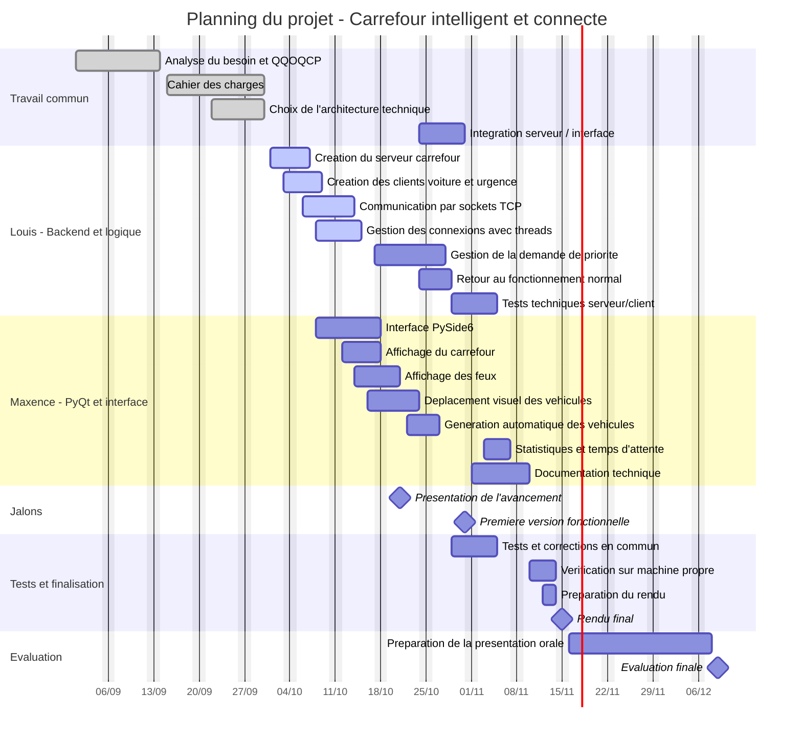

# Diagramme de Gantt - Carrefour intelligent et connecte

Ce planning est construit a partir du cahier des charges du projet.

Il s'agit du planning previsionnel etabli au lancement du projet : les dates et l'etat des taches ne sont pas synchronises automatiquement avec le depot de code.

Il reprend les grandes etapes prevues entre septembre 2026 et decembre 2026, avec une repartition pour 2 personnes :

- **Louis** : backend, logique metier, sockets, threads, priorite, tests techniques ;
- **Maxence** : interface PyQt/PySide6, affichage du carrefour, feux, vehicules, documentation ;
- **Travail commun** : analyse, cahier des charges, integration, verification finale, presentation.

## Diagramme de Gantt

## Planning detaille

| Periode | Louis | Maxence | Livrable / jalon |
|---|---|---|---|
| 1 au 14 septembre 2026 | Analyse du besoin | Analyse du besoin | Besoin compris |
| 15 au 30 septembre 2026 | Architecture technique | Cahier des charges | Cahier des charges termine |
| 1 au 9 octobre 2026 | Serveur et clients TCP | Premiers tests d'interface | Base serveur/client |
| 6 au 15 octobre 2026 | Sockets TCP et threads | Preparation affichage graphique | Plusieurs vehicules connectes |
| 12 au 21 octobre 2026 | Stabilisation reseau | Interface PySide6, carrefour et feux | Premiere interface |
| 17 au 29 octobre 2026 | Vehicule prioritaire, priorite, retour normal | Deplacement visuel et integration | Prototype fonctionnel |
| 21 octobre 2026 | Presentation avancement | Presentation avancement | Prototype de base |
| 29 octobre au 5 novembre 2026 | Tests serveur/client | Tests interface/simulation | Version beta stabilisee |
| 1 au 10 novembre 2026 | Corrections techniques | Documentation technique | Documentation complete |
| 10 au 14 novembre 2026 | Verification machine propre | Preparation rendu | Livraison prete |
| 15 novembre 2026 | Rendu final | Rendu final | Projet rendu |
| 16 novembre au 8 decembre 2026 | Preparation orale technique | Preparation orale fonctionnelle | Support de presentation |
| 9 ou 10 decembre 2026 | Evaluation finale | Evaluation finale | Presentation du projet |

## Repartition du travail

| Membre | Responsabilites principales |
|---|---|
| Louis | backend, serveur TCP, clients, sockets, threads, logique de priorite urgence, tests reseau |
| Maxence | PyQt/PySide6, interface graphique, affichage du carrefour, feux, vehicules, statistiques, documentation |
| Les deux | cadrage, integration, tests finaux, preparation du rendu, presentation orale |

## Repartition par priorite MoSCoW

| Priorite | Taches concernees |
|---|---|
| Must have | serveur, clients, sockets TCP, threads, interface, feux, voitures, urgence, priorite, retour normal, tests, documentation |
| Should have | temps d'attente, statistiques simples |
| Could have | generation automatique, scenarios de circulation, mode jeu |
| Won't have | ville complete, IA, itineraire, donnees reelles, vrais feux de circulation |

## Remarque

Le mode jeu est indique dans le cahier des charges comme une fonctionnalite bonus. Il n'est donc pas place dans le chemin critique du planning.
