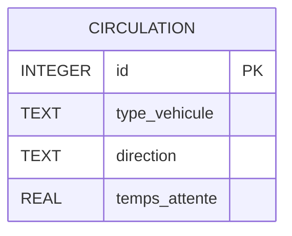
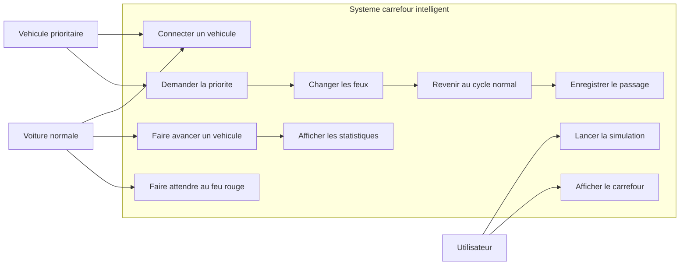
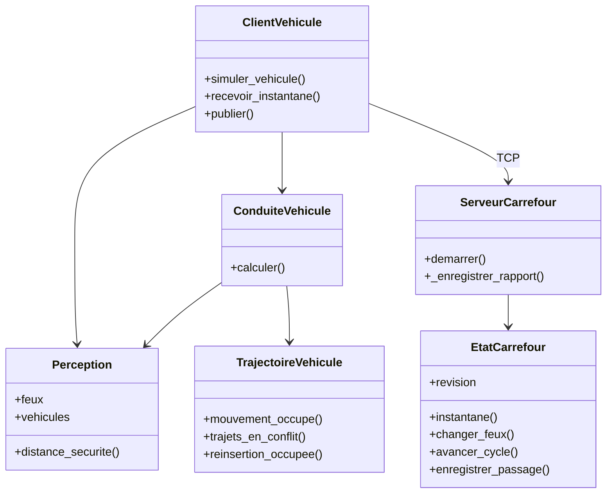
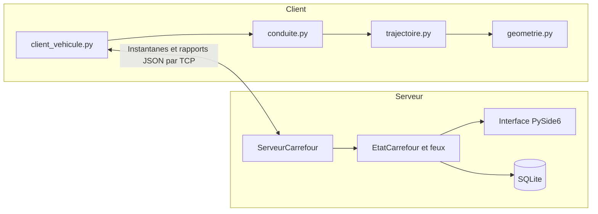
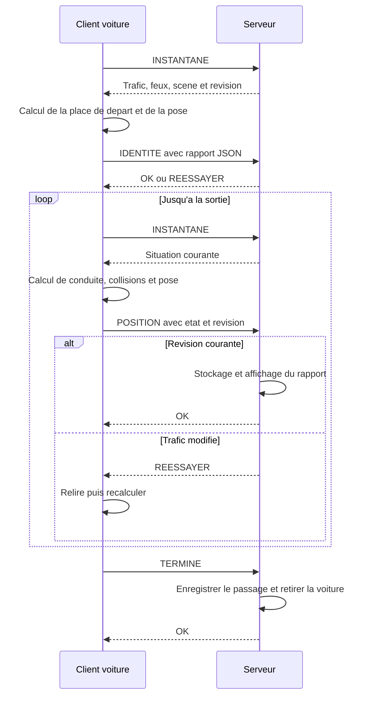
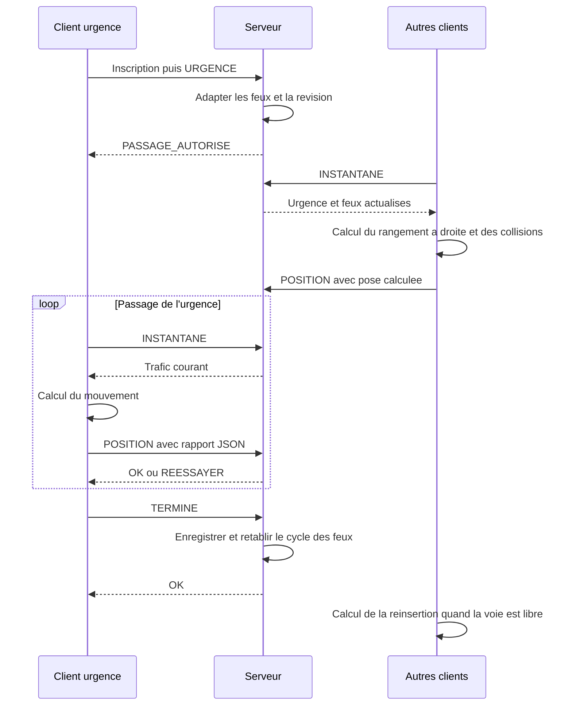
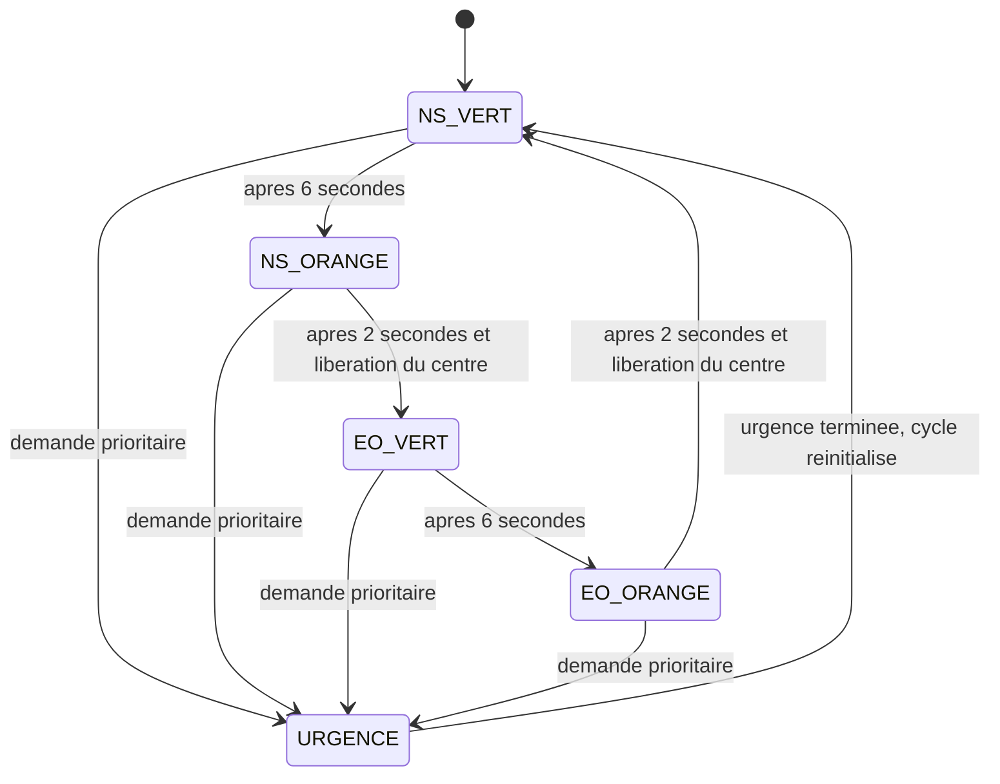
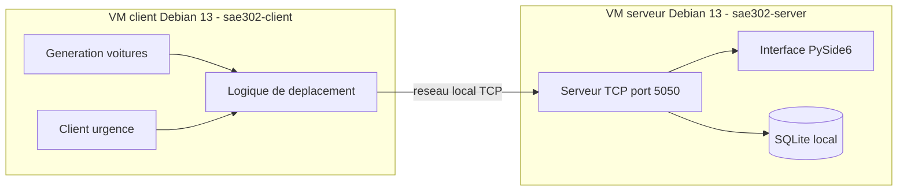

# Documentation technique - Carrefour intelligent

## 1. Presentation du projet

Ce projet est une simulation de carrefour intelligent realisee en Python.

Le but est de montrer comment un carrefour peut communiquer avec des vehicules normaux et un vehicule prioritaire. Quand une ambulance, un pompier ou une voiture de police arrive, elle envoie une demande de priorite au serveur. Le carrefour adapte alors ses feux pour faciliter son passage, puis revient au fonctionnement normal.

Le projet contient :

- un serveur TCP avec interface graphique ;
- des clients TCP pour les voitures normales ;
- un client TCP pour le vehicule prioritaire ;
- des statistiques simples et une base SQLite pour les passages ;
- des tests automatises simples.

## 2. Technologies utilisees

| Element | Technologie |
|---|---|
| Langage | Python 3.13 sur Debian 13 |
| Interface graphique | PySide6 |
| Communication reseau | sockets TCP |
| Concurrence | threading |
| Base de donnees | SQLite |
| Tests | unittest |

Les librairies `socket`, `threading`, `sqlite3`, `time` et `random` font partie de Python.

Les dossiers `server/` et `client/` fonctionnent separement. Chaque machine peut ne recevoir que son dossier. Le port doit etre configure de la meme facon cote client et serveur. Les parametres de conduite (ligne d'arret, pas d'avancement, delai et distances) sont definis dans `client/config.py`. Les clients utilisent uniquement la bibliotheque standard de Python.

## 3. Structure du projet

```text
SAE302/
├── README.md
├── lancer_simulation.sh
├── Stack_Technique.md
├── requirements.txt
├── server/
│   ├── carrefour.py
│   ├── config.py
│   ├── requirements.txt
│   ├── lancer_serveur.sh
│   ├── model/
│   │   ├── BaseDonnees.py
│   │   ├── EtatCarrefour.py
│   │   ├── FenetreCarrefour.py
│   │   ├── ServeurCarrefour.py
│   │   ├── Vehicule.py
│   │   └── VueCarrefour.py
│   └── data/                 # Cree au lancement, contient carrefour.sqlite3
├── client/
│   ├── voiture.py
│   ├── urgence.py
│   ├── client_vehicule.py     # Transport TCP
│   ├── conduite.py            # Decisions et controles de circulation
│   ├── trajectoire.py         # Trajectoires et collisions
│   ├── geometrie.py           # Courbes et contours sans Qt
│   ├── vehicule.py            # Etat local du vehicule
│   ├── config.py
│   └── lancer_simulation.sh
├── tests/
│   └── test_separation.py
├── packaging/
│   ├── build_deb.py          # Construction des paquets client et serveur
│   └── debian/               # Configurations système par rôle
├── dist/                     # Paquets générés (ignorés par Git)
└── doc/
    ├── Installation.md
    ├── Documentation_Technique.md
    ├── Diagramme_Gantt.md
    └── Stack_Technique.md
```

## 4. Installation

Le déploiement cible comporte deux VM **Debian 13** séparées. Le paquet
`sae302-server` installe l'interface et le serveur sur la VM avec bureau graphique ;
`sae302-client` installe les générateurs sur la seconde VM. La construction se fait
avec `python3 packaging/build_deb.py`, sans dépendance externe de construction.
Les archives suivent le [format Debian 2.0](https://manpages.debian.org/trixie/dpkg-dev/deb.5.en.html).

Les dépendances du serveur sont résolues par APT, notamment
[`python3-pyside6.qtwidgets`](https://packages.debian.org/trixie/python3-pyside6.qtwidgets)
(et ses dépendances QtCore/QtGui). Les paquets utilisent la version Debian de
PySide6, 6.8.2.1 ; les requirements de développement épinglent 6.9.2.
Le client utilise Python standard. Le serveur se lance sous l'utilisateur de la
session graphique, sans service systemd. Le [guide d'installation](Installation.md)
détaille le déploiement et sa vérification.

Pour un environnement de développement depuis les sources :

Depuis la racine du projet :

```bash
python3 -m venv .venv
source .venv/bin/activate
pip install -r requirements.txt
```

Sur Windows :

```bash
python -m venv .venv
.venv\Scripts\activate
pip install -r requirements.txt
```

## 5. Lancement

### Paquets sur deux VM

Sur la VM serveur, lancer `sae302-server` depuis la session graphique. Sur la VM
client, renseigner l'IP du serveur dans `/etc/sae302/client.conf`, puis lancer
`sae302-client 3 0.4`. Le trafic cible par défaut les deux onglets ; ajouter `T`
ou `CROIX` en troisième argument pour un seul carrefour.


### Lancement manuel

Terminal 1 :

```bash
python3 -m server.carrefour
```

Terminal 2 :

```bash
python3 -m client.voiture 3
```

Terminal 3 :

```bash
python3 -m client.urgence Ambulance N
```

Les directions possibles sont :

- `N` : Nord ;
- `S` : Sud ;
- `E` : Est ;
- `O` : Ouest.

### Lancement automatique

```bash
bash lancer_simulation.sh 3 0.4
```

Le nombre `3` correspond à la densité des voitures ; `0.4` est la densité des ambulances. Ce lanceur racine sert au développement sur une seule machine. Sur les deux VM, lancer le serveur séparément et utiliser le lanceur client.

## 6. Fonctionnement general

1. Le serveur demarre les deux carrefours, gere les feux et recoit les connexions TCP.
2. Le client choisit un trajet autorise et demande un instantane du trafic.
3. Le client calcule sa place de depart, puis publie son etat complet.
4. A chaque pas, il relit le trafic et calcule lui-meme les distances, collisions, priorites de passage et mouvements lateraux.
5. Il transmet sa progression, son attente, son occupation du centre et sa pose graphique au serveur.
6. Le serveur stocke cet etat et le dessine. Si le trafic a change depuis l'instantane, il demande au client de relire et recalculer.
7. Une urgence demande une adaptation des feux au serveur ; les autres clients calculent comment lui laisser la place.
8. Le client signale sa sortie et le serveur enregistre le passage dans SQLite.

Les coordonnees sont calculees par le client dans une scene logique de 1000 par 600. L'interface adapte cette scene a la taille de la fenetre.

## 7. Protocole TCP

Chaque message se termine par un retour a la ligne. Le premier `|` separe la commande du contenu JSON, lorsqu'il existe.

| Commande | Contenu | Reponse |
|---|---|---|
| `CARREFOUR` | `T` ou `CROIX`, avant inscription | `OK` |
| `GET_TRAJETS` | Aucun | `TRAJETS` et trajets autorises en JSON |
| `INSTANTANE` | Aucun | `INSTANTANE` et etat du trafic en JSON |
| `IDENTITE` | Rapport JSON calcule par le client | `OK` ou `REESSAYER` |
| `POSITION` | Rapport JSON calcule par le client | `OK` ou `REESSAYER` |
| `URGENCE` | Aucun, apres inscription | `PASSAGE_AUTORISE` |
| `ETAT` | Aucun, apres inscription | `FEU|direction|couleur` |
| `TERMINE` | Aucun, apres progression 100 | `OK` |

Un rapport contient `revision` et `vehicule`. Le vehicule porte son identite, son trajet, sa progression, ses indicateurs de conduite, son temps d'attente et `position_affichage` : `[x, y, angle, longueur, largeur]`.

L'instantane contient la revision, les feux, les trajets, la geometrie fixe de la scene et les etats des vehicules. Une modification du trafic ou des feux augmente la revision. Une mise a jour du seul compteur d'attente ne la modifie pas.

Le serveur compare la revision avant de stocker un rapport, sous verrou. Si elle a change, il repond `REESSAYER` : le client recupere un nouvel instantane et refait ses calculs. Cela evite que deux clients publient des mouvements calcules sur une situation devenue ancienne. Le serveur controle le format et l'identite de connexion ; tous les controles de conduite sont executes par les clients.

Une commande invalide produit `ERREUR|message`. L'ancien protocole `POSITION|nombre` n'est plus utilise : il faut redemarrer les clients et le serveur ensemble apres cette mise a jour.

## 8. Base de donnees et statistiques

`EtatCarrefour` garde trois compteurs en memoire : passages termines, urgences traitees et temps d'attente total. Ils sont remis a zero au prochain lancement. La base (`server/data/carrefour.sqlite3` depuis les sources ; `~/.local/share/sae302/carrefour.sqlite3` avec le paquet, sauf `XDG_DATA_HOME` ou `SAE302_DB_PATH`) conserve chaque passage termine dans une table `circulation` : `id`, `type_vehicule`, `direction` et `temps_attente`. Une ancienne table `passages` peut rester dans une base deja utilisee ; elle n'est pas effacee.



## 9. UML - Cas d'utilisation



## 10. UML - Diagramme de classes



Le modele client `Vehicule` contient les methodes de trajet. Le modele serveur conserve uniquement les champs recus. Le serveur ne depend d'aucun module client.

## 11. UML - Diagramme de composants



## 12. UML - Sequence voiture normale



## 13. UML - Sequence vehicule prioritaire



## 14. UML - Cycle des feux



## 15. UML - Deploiement sur deux machines



## 16. Regles de gestion principales

- Chaque client calcule sa place de depart et tous les pas de sa voiture.
- Le client controle le feu, les distances, les contours balayes et les conflits de trajectoire avant de publier un mouvement.
- Une voiture tournera a gauche sur sa trajectoire habituelle et cedera a la circulation opposee. Le depassement a droite commence pres de la ligne, une fois la voiture precedente engagee dans son virage a gauche.
- Les clients calculent le rangement pour une urgence et la reinsertion quand la place est libre.
- Le client produit aussi les coordonnees, dimensions et orientation a dessiner, ainsi que son indicateur d'occupation du centre.
- Le serveur gere le cycle des feux, la demande de priorite, les revisions des rapports et les statistiques. Il utilise l'occupation declaree par les clients avant de changer d'axe au vert.
- Une revision ancienne impose une nouvelle lecture et un nouveau calcul cote client.
- Le temps d'attente est calcule par le client et additionne par le serveur.

Pour les paquets, `/etc/sae302/client.conf` définit `SAE302_HOST` et `SAE302_PORT` ;
`/etc/sae302/server.conf` définit `SAE302_BIND_HOST`, `SAE302_PORT` et éventuellement
`SAE302_DB_PATH`. Les fichiers sont chargés par les lanceurs et conservés comme
fichiers de configuration Debian. Les sources utilisent les mêmes variables
d'environnement, avec repli sur les valeurs des modules `config.py`.
Les paramètres de conduite restent locaux à `client/config.py`.
Le serveur écoute par défaut sur `0.0.0.0:5050` ; le client doit cibler l'IP réelle
de la VM serveur. Aucun module serveur n'est installé dans le paquet client, ni
module client dans le paquet serveur. Le réseau de TP doit autoriser TCP 5050.

## 17. Tests

La suite couvre les files de voitures, les collisions au redemarrage, les deux types de carrefours, les trajectoires, les virages a gauche, les depassements et le passage des ambulances. Les tests de conduite executent les modules clients.

Les tests TCP verifient aussi le stockage exact de la pose calculee par le client, le recalcul apres une modification du trafic ou des feux, les arrivees simultanees, les passages complets et les statistiques SQLite. Un client copie seul est execute sans PySide6 ni acces aux fichiers serveur ; un serveur copie seul est importe sans les modules clients.

```bash
python3 -m unittest discover -s tests
```

## 18. Limites connues

- La simulation reste un prototype pour reseau local.
- Les vehicules ne suivent pas une vraie physique de circulation.
- Les trajets sont simplifies, y compris pour les virages.
- Il n'y a pas de gestion d'une ville complete.
- Il n'y a pas d'intelligence artificielle.

## 19. Ameliorations possibles

- Ajouter plusieurs scenarios de circulation.
- Ajouter un mode jeu.
- Ajouter un bouton dans l'interface pour lancer une urgence.
- Ajouter des graphiques de statistiques.
- Ameliorer le dessin du carrefour avec `QGraphicsScene`.

## 20. Planning

Le diagramme de Gantt du projet est disponible dans le fichier suivant :

[Diagramme de Gantt](Diagramme_Gantt.md)
