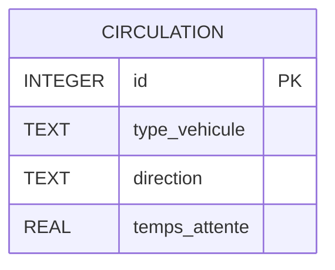
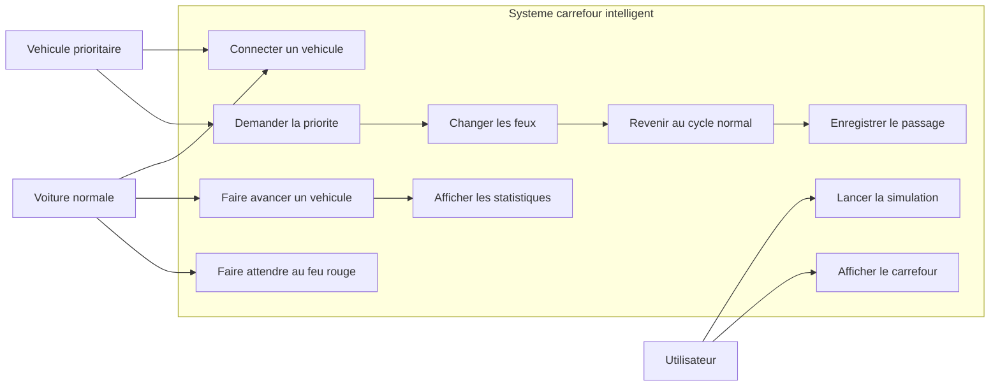
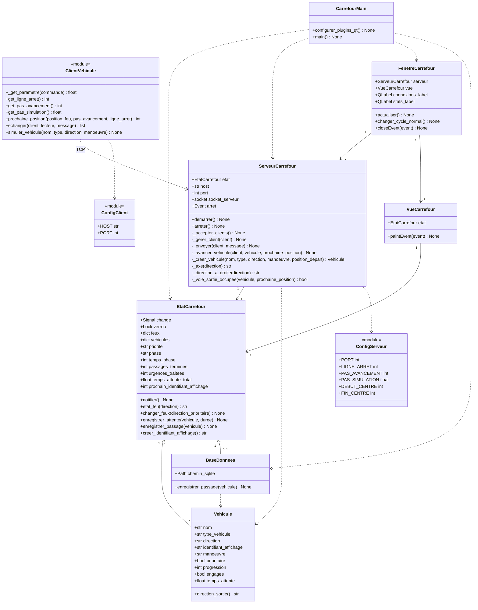
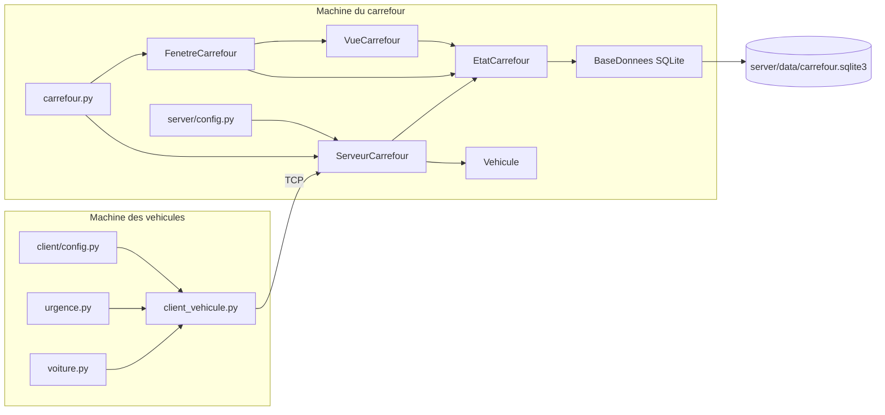
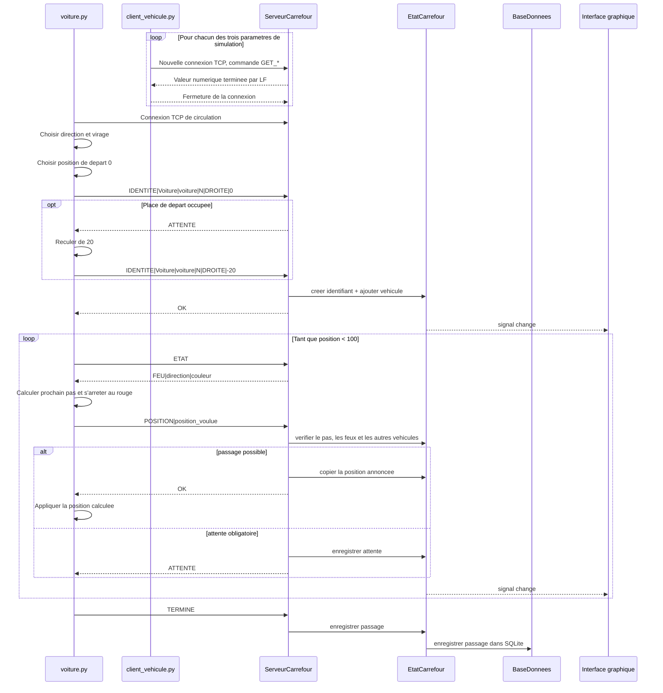
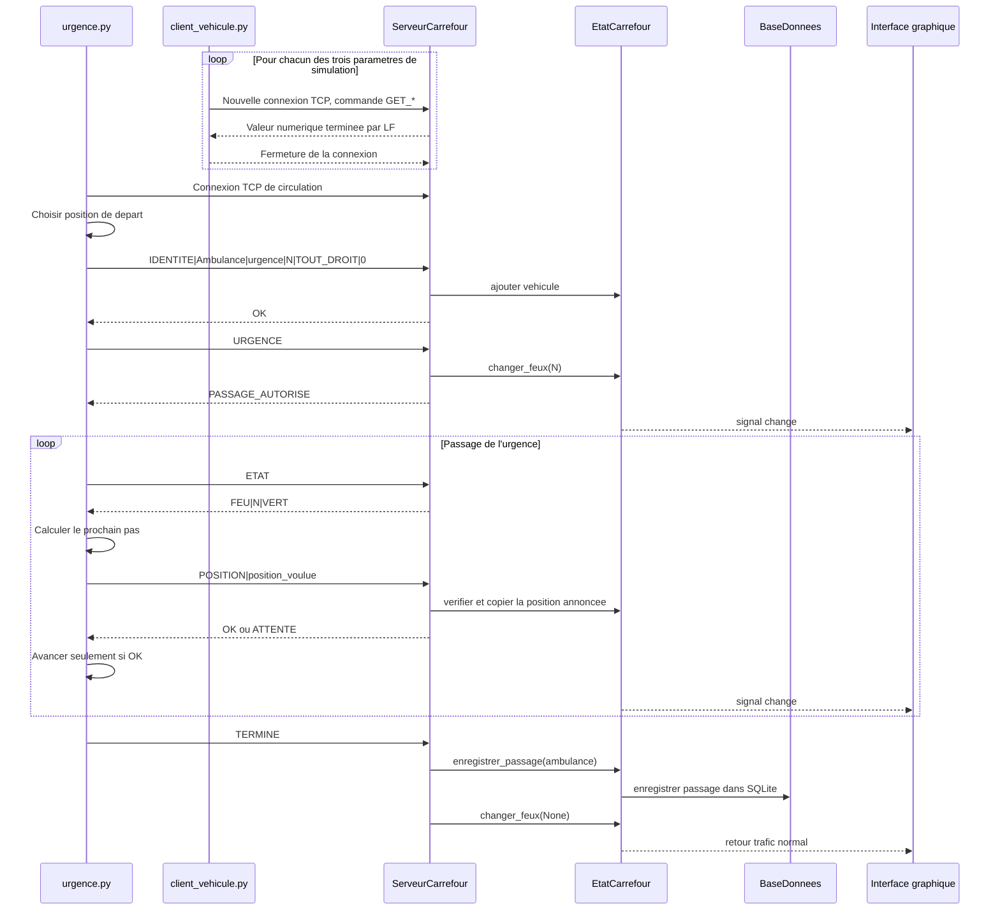
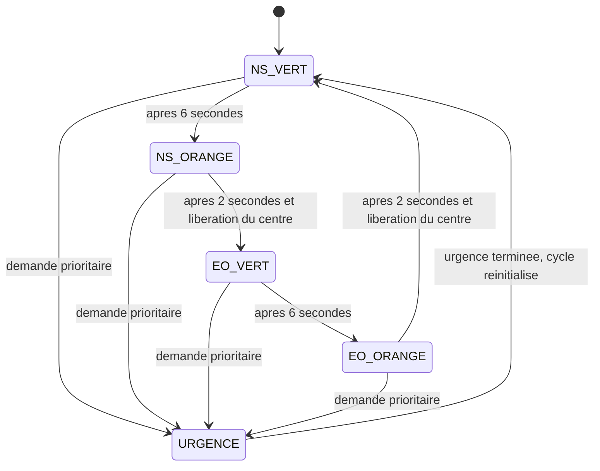
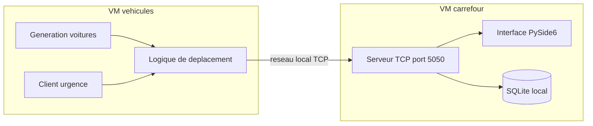

# Documentation technique - Carrefour intelligent

## 1. Presentation du projet

Ce projet est une simulation de carrefour intelligent realisee en Python.

Le but est de montrer comment un carrefour peut communiquer avec des vehicules normaux et un vehicule prioritaire. Quand une ambulance, un pompier ou une voiture de police arrive, elle envoie une demande de priorite au serveur. Le carrefour adapte alors ses feux pour faciliter son passage, puis revient au fonctionnement normal.

Le projet contient :

- un serveur TCP avec interface graphique ;
- des clients TCP pour les voitures normales ;
- un client TCP pour le vehicule prioritaire ;
- des statistiques simples et une base SQLite pour les passages ;
- des tests automatises simples.

## 2. Technologies utilisees

| Element | Technologie |
|---|---|
| Langage | Python 3 |
| Interface graphique | PySide6 |
| Communication reseau | sockets TCP |
| Concurrence | threading |
| Base de donnees | SQLite |
| Tests | unittest |

Les librairies `socket`, `threading`, `sqlite3`, `time` et `random` font partie de Python.

Les dossiers `server/` et `client/` fonctionnent separement. Chaque machine peut ne recevoir que son dossier. Le port doit etre configure de la meme facon cote client et serveur. Les parametres de simulation (ligne d'arret, pas d'avancement et delai) sont definis par le serveur et transmis aux clients au demarrage de chaque vehicule.

## 3. Structure du projet

```text
SAE302/
├── README.md
├── lancer_simulation.sh
├── Stack_Technique.md
├── requirements.txt
├── server/
│   ├── carrefour.py
│   ├── config.py
│   ├── requirements.txt
│   ├── lancer_serveur.sh
│   ├── model/
│   │   ├── BaseDonnees.py
│   │   ├── EtatCarrefour.py
│   │   ├── FenetreCarrefour.py
│   │   ├── ServeurCarrefour.py
│   │   ├── Vehicule.py
│   │   └── VueCarrefour.py
│   └── data/                 # Cree au lancement, contient carrefour.sqlite3
├── client/
│   ├── voiture.py
│   ├── urgence.py
│   ├── client_vehicule.py
│   ├── config.py
│   └── lancer_simulation.sh
├── tests/
│   └── test_separation.py
└── doc/
    ├── Installation.md
    ├── Documentation_Technique.md
    ├── Diagramme_Gantt.md
    ├── Stack_Technique.md
    └── Releve_Decisions_S40_2026.md
```

## 4. Installation

Depuis la racine du projet :

```bash
python3 -m venv .venv
source .venv/bin/activate
pip install -r requirements.txt
```

Sur Windows :

```bash
python -m venv .venv
.venv\Scripts\activate
pip install -r requirements.txt
```

## 5. Lancement

### Lancement manuel

Terminal 1 :

```bash
python3 -m server.carrefour
```

Terminal 2 :

```bash
python3 -m client.voiture 3
```

Terminal 3 :

```bash
python3 -m client.urgence Ambulance N
```

Les directions possibles sont :

- `N` : Nord ;
- `S` : Sud ;
- `E` : Est ;
- `O` : Ouest.

### Lancement automatique

```bash
bash lancer_simulation.sh 3
```

Le nombre `3` correspond a la densite de circulation.

## 6. Fonctionnement general

1. Le serveur du carrefour demarre sur `0.0.0.0:5050`.
2. L'interface graphique affiche le carrefour, les feux et les vehicules.
3. Les voitures normales se connectent au serveur avec une socket TCP.
4. Chaque voiture choisit sa direction et son virage, puis calcule son prochain pas.
5. Le serveur indique le feu et repond `OK` ou `ATTENTE` aux positions annoncees.
6. Si le feu est rouge, la voiture attend a la ligne d'arret.
7. Si un vehicule prioritaire demande la priorite, le serveur passe son feu au vert.
8. Apres son passage, les feux reviennent au cycle normal.
9. Les passages sont enregistres dans SQLite et les compteurs sont affiches en memoire.

## 7. Protocole TCP

Les messages sont envoyes en texte, avec le separateur `|`.

| Commande client | Exemple | Role |
|---|---|---|
| `IDENTITE` | `IDENTITE|Voiture-1|voiture|N|DROITE|0` | Declare le trajet et la position de depart choisis par le client |
| `IDENTITE` | `IDENTITE|Ambulance|urgence|N|TOUT_DROIT|0` | Declare une urgence |
| `GET_LIGNE_ARRET` | `GET_LIGNE_ARRET` | Demande la ligne d'arret configuree par le serveur |
| `GET_PAS_AVANCEMENT` | `GET_PAS_AVANCEMENT` | Demande le pas maximal d'avancement configure par le serveur |
| `GET_PAS_SIMULATION` | `GET_PAS_SIMULATION` | Demande le delai entre deux iterations configure par le serveur |
| `ETAT` | `ETAT` | Demande la couleur du feu |
| `URGENCE` | `URGENCE` | Demande la priorite |
| `POSITION` | `POSITION|31` | Annonce la prochaine position calculee par le vehicule |
| `TERMINE` | `TERMINE` | Signale la fin du passage |

| Reponse serveur | Exemple | Role |
|---|---|---|
| `FEU` | `FEU|N|VERT` | Donne seulement la couleur du feu |
| `PASSAGE_AUTORISE` | `PASSAGE_AUTORISE` | Autorise l'urgence |
| `OK` | `OK` | Position de depart ou deplacement accepte |
| `ATTENTE` | `ATTENTE` | Depart occupe ou deplacement refuse |
| Reponse numerique | `1` ou `0.08` | Valeur demandee par une commande `GET_*` |

Les commandes se terminent par un retour a la ligne. Chaque requete `GET_*` utilise une connexion TCP dediee : le serveur repond par la valeur numerique suivie d'un retour a la ligne, puis le client ferme cette connexion. Le client recupere ainsi la ligne d'arret, le pas d'avancement et le delai de simulation avant d'ouvrir sa connexion de circulation. Le client garde sa position dans son propre programme. Avec `OK`, il applique le pas qu'il a calcule ; avec `ATTENTE`, il garde sa position actuelle. A l'inscription, si la place de depart est prise, il choisit une place 20 % plus loin en arriere et reessaie. Le serveur ne renvoie jamais la position du vehicule : il en garde seulement une copie pour l'affichage et les regles de circulation.

## 8. Base de donnees et statistiques

`EtatCarrefour` garde trois compteurs en memoire : passages termines, urgences traitees et temps d'attente total. Ils sont remis a zero au prochain lancement. La base `server/data/carrefour.sqlite3` conserve chaque passage termine dans une table `circulation` : `id`, `type_vehicule`, `direction` et `temps_attente`. Une ancienne table `passages` peut rester dans une base deja utilisee ; elle n'est pas effacee.



## 9. UML - Cas d'utilisation



## 10. UML - Diagramme de classes



## 11. UML - Diagramme de composants



## 12. UML - Sequence voiture normale



## 13. UML - Sequence vehicule prioritaire



## 14. UML - Cycle des feux



## 15. UML - Deploiement sur deux machines



## 16. Regles de gestion principales

- Chaque vehicule calcule des pas de `1 %` et propose sa prochaine position au serveur.
- Le serveur refuse un saut trop grand ou un passage dangereux.
- Une voiture s'arrete a la ligne d'arret si son feu n'est pas vert.
- Une voiture garde une distance minimale avec les voitures devant elle.
- Le carrefour evite de faire entrer deux axes differents en meme temps.
- Une urgence rend sa direction verte et les autres rouges.
- Quand l'urgence a termine son passage, les feux reviennent au cycle normal.
- Le temps d'attente est augmente quand le serveur renvoie `ATTENTE`.

Pour utiliser deux VM, remplacer `HOST` dans `client/config.py` par l'IP du carrefour. Le serveur ecoute deja sur le reseau. Les clients n'ont pas besoin de PySide6.

## 17. Tests

Le fichier `tests/test_separation.py` contient des scenarios portant sur :

- la connexion d'une voiture normale ;
- la position calculee par le client et copiee par le serveur ;
- la priorite d'un vehicule d'urgence ;
- le refus d'un saut trop grand et d'un passage au rouge ;
- le trajet complet d'une voiture et d'une ambulance par TCP ;
- le choix d'une place de depart par deux clients.

Commande :

```bash
python3 -m unittest discover -s tests
```

## 18. Limites connues

- La simulation reste un prototype pour reseau local.
- Les vehicules ne suivent pas une vraie physique de circulation.
- Les trajets sont simplifies, y compris pour les virages.
- Il n'y a pas de gestion d'une ville complete.
- Il n'y a pas d'intelligence artificielle.

## 19. Ameliorations possibles

- Ajouter plusieurs scenarios de circulation.
- Ajouter un mode jeu.
- Ajouter un bouton dans l'interface pour lancer une urgence.
- Ajouter des graphiques de statistiques.
- Ameliorer le dessin du carrefour avec `QGraphicsScene`.

## 20. Planning

Le diagramme de Gantt du projet est disponible dans le fichier suivant :

[Diagramme de Gantt](Diagramme_Gantt.md)
